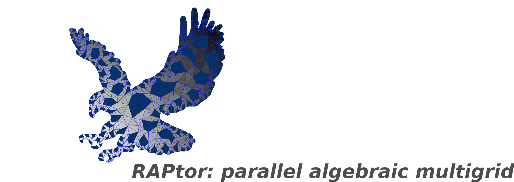

[](https://github.com/raptor-library/raptor/actions?query=workflow%3Aci+branch%3Amain)
[](https://app.codecov.io/gh/raptor-library/raptor)
[](https://github.com/raptor-library/raptor/releases)
[](https://raptor-library.github.io/raptor/)



# raptor

RAPtor is a general, high performance algebraic multigrid solver.

# Features

- Parallel (MPI) sparse matrices:
  -  COO, CSR, and CSC formats, with block variants (BCOO, BSR, BSC)
- Ruge-Stüben (classical) AMG:
  - RS, CLJP, Falgout, PMIS, and HMIS coarsening;
  - direct, modified classical, extended, and one-point interpolation
- AIR (approximate ideal restriction) AMG
- Smoothed aggregation AMG:
  - CSR, BSR
- Relaxation:
  - Jacobi, SOR, SSOR, and block Jacobi relaxation
- Krylov methods:
  -  CG, BiCGStab
- Node-aware (topology-aware) communication
- Interfaces to hypre, MFEM, PETSc, and Trilinos MueLu

# Requirements

- A C++17 compiler
- `MPI`
- `cmake` (version 3.12 or newer)
- `BLAS` and `LAPACK`
  - GoogleTest (via Cmake)


# Build Instructions

1. Configure the build

```bash
cmake -Bbuild [OPTIONS]
```

2. Build the RAPtor library
```bash
cmake --build build --parallel
```

3. Test RAPtor
```bash
ctest --test-dir build -V
```

Note: to test with a hostfile, `hostfile.txt`, use
```
cmake -Bbuild -DWITH_HOSTFILE=ON -DHOSTFILE=<full path to>/hostfile.txt
cmake --build build --parallel
ctest --test-dir build -V
```

## Options

Options are passed at configure time, e.g. `cmake -Bbuild -DWITH_HYPRE=ON`.

### Build

| Option | Default | Description |
|---|---|---|
| `BUILD_SHARED_LIBS` | `ON` | Build `raptor` as a shared library |
| `BUILD_EXAMPLES` | `ON` | Build the examples in `examples/` |
| `ENABLE_UNIT_TESTS` | `ON` | Build the GoogleTest unit tests and register with `ctest` |
| `ENABLE_COVERAGE` | `OFF` | Compile the unit tests with coverage |
| `WITH_MPI` | `ON` | Build with MPI |
| `WITH_AMPI` | `OFF` | Build with Adaptive MPI (AMPI) |
| `WITH_HOSTFILE` | `OFF` | Pass a hostfile to `mpirun` when running tests |
| `HOSTFILE` | | Full path to the hostfile; used with `WITH_HOSTFILE=ON` |

### External packages

External packages must be installed before enabling them.  If a package is not
installed in a standard location, set its `<PACKAGE>_DIR` option.

| Option | Default | Description |
|---|---|---|
| `WITH_HYPRE` | `OFF` | Build `hypre_wrapper` (set `HYPRE_DIR` to the directory containing `include` and `lib`) |
| `WITH_MFEM` | `OFF` | Build `mfem_wrapper` and the MFEM matrix gallery; also enables hypre and requires Metis (set `MFEM_DIR`, `HYPRE_DIR`, `METIS_DIR`; optionally `MFEM_MESH_DIR`) |
| `WITH_PETSC` | `OFF` | Build `petsc_wrapper` (set `PETSC_DIR`) |
| `WITH_MUELU` | `OFF` | Build `trilinos_wrapper` for Trilinos MueLu (set `MUELU_DIR`) |
| `WITH_PARMETIS` | `OFF` | Enable ParMETIS partitioning (set `PARMETIS_DIR`) |
| `WITH_PTSCOTCH` | `OFF` | Enable PT-Scotch partitioning (set `PTSCOTCH_DIR`) |

### Tips

- **Link time optimization (LTO):** LTO can speed things up --- enable it with
  ```bash
  cmake -Bbuild -DCMAKE_INTERPROCEDURAL_OPTIMIZATION=ON
  ```
- **TAU profiling:** to build with the TAU compiler wrappers use
  ```bash
  export TAU_MAKEFILE=<TAU install>/lib/Makefile.tau-<config>
  export TAU_OPTIONS="-optVerbose -optCompInst"
  cmake -Bbuild -DCMAKE_C_COMPILER=tau_cc.sh -DCMAKE_CXX_COMPILER=tau_cxx.sh
  ```
  where `TAU_MAKEFILE` points to a TAU configuration built with MPI support.

## Unit Testing

Unit tests use GoogleTest and run through `ctest`.  Each `tests/`
directory registers its tests in its own `CMakeLists.txt` with `add_test`;
parallel tests typically run at several MPI rank counts (e.g. 1, 4, 16).  For a simple example, see
`raptor/core/tests/test_par_vector.cpp`.

# Installing and Using RAPtor

To install the library, headers, and CMake package files:
```bash
cmake -Bbuild -DCMAKE_INSTALL_PREFIX=<install path>
cmake --build build --parallel
cmake --install build
```

To link to CMake project:
```cmake
find_package(raptor REQUIRED)
target_link_libraries(my_app PRIVATE raptor::raptor)
```

If RAPtor is not installed in a standard location, use
`-Draptor_DIR=<install path>/lib/cmake/raptor` (or add the install path to
`CMAKE_PREFIX_PATH`).

Include `raptor/raptor.hpp` to use RAPtor.

# Documentation

Online documentation: https://raptor-library.github.io/raptor/

Documentation is generated with Doxygen:
```bash
cmake -Bbuild
cmake --build build --target docs
```

# Citing

<pre>
@MISC{raptor2026,
      author = {Bienz, Amanda and Olson, Luke N. and Lockhart, Shelby and
                Reisner, Andrew and Southworth, Ben and Shen, Taoli},
      title = {{RAPtor}: parallel algebraic multigrid v1.0},
      year = {2026},
      url = {https://github.com/raptor-library/raptor},
      note = {Release 1.0}
      }
</pre>

# Full Example

With `BUILD_EXAMPLES=ON` (the default), the example is built in `build/examples`:
```
cd build/examples
mpirun -n 4 ./example
```

This example is maintained in `examples/example.cpp`

```cpp
// SPDX-FileCopyrightText: RAPtor Developers, University of Illinois Urbana-Champaign
// SPDX-License-Identifier: BSD-2-Clause
// See LICENSE.txt top-level directory for the full license.
#include <mpi.h>
#include <math.h>
#include <stdlib.h>
#include <assert.h>
#include <iostream>

// Include raptor
#include "raptor/raptor.hpp"

using namespace raptor;

// This is a basic use case.
int main(int argc, char *argv[])
{
    // set rank and number of processors
    int rank, num_procs;
    MPI_Init(&argc, &argv);
    MPI_Comm_rank(MPI_COMM_WORLD, &rank);
    MPI_Comm_size(MPI_COMM_WORLD, &num_procs);

    // Create parallel matrix and vectors
    ParCSRMatrix* A;
    ParVector x;
    ParVector b;

    // Timers
    double time_setup, time_solve, time_base;

    // Problems size and type
    int dim = 2;
    int n = 100;

    std::vector<int> grid;
    grid.resize(dim, n);

    // Anisotropic diffusion
    coarsen_t coarsen_type = CLJP;
    interp_t interp_type = ModClassical;
    relax_t relax_type = SOR;
    double eps = 0.001;
    double theta = M_PI/8.0;
    double* stencil = NULL;
    stencil = diffusion_stencil_2d(eps, theta);
    A = par_stencil_grid(stencil, grid.data(), dim);
    delete[] stencil;

    x = ParVector(A->global_num_cols, A->on_proc_num_cols);
    b = ParVector(A->global_num_rows, A->local_num_rows);

    x.set_const_value(1.0);
    A->mult(x, b);
    x.set_const_value(0.0);

    // AMG parameters
    double strong_threshold = 0.25;

    // Create a multilevel object
    ParMultilevel* ml;

    // Setup Raptor Hierarchy
    MPI_Barrier(MPI_COMM_WORLD);
    time_base = MPI_Wtime();
    ml = new ParRugeStubenSolver(strong_threshold, coarsen_type, interp_type, Classical, relax_type);
    ml->setup(A);
    time_setup = MPI_Wtime() - time_base;

    // Print out information on the AMG hierarchy
    int64_t lcl_nnz;
    int64_t nnz;

    if (rank == 0) std::cout << "Level\tNumRows\tNNZ" << std::endl;
    if (rank == 0) std::cout << "-----\t-------\t---" << std::endl;
    for (int64_t i = 0; i < ml->num_levels; i++)
    {
        ParCSRMatrix* Al = ml->levels[i]->A;
        lcl_nnz = Al->local_nnz;
        MPI_Reduce(&lcl_nnz, &nnz, 1, MPI_LONG, MPI_SUM, 0, MPI_COMM_WORLD);
        if (rank == 0) std::cout << i << "\t" << Al->global_num_rows << "\t" << nnz << std::endl;
    }

    // Solve Raptor Hierarchy
    MPI_Barrier(MPI_COMM_WORLD);
    time_base = MPI_Wtime();
    ml->solve(x, b);
    time_solve = MPI_Wtime() - time_base;

    MPI_Reduce(&time_setup, &time_base, 1, MPI_DOUBLE, MPI_MAX, 0, MPI_COMM_WORLD);
    if (rank == 0) printf("Raptor AMG Setup Time: %e\n", time_base);
    MPI_Reduce(&time_solve, &time_base, 1, MPI_DOUBLE, MPI_MAX, 0, MPI_COMM_WORLD);
    if (rank == 0) printf("Raptor AMG Solve Time: %e\n", time_base);

    // Delete AMG hierarchy
    delete ml;
    delete A;
    MPI_Finalize();

    return 0;
}

```

# License

This code is distributed under BSD: http://opensource.org/licenses/BSD-2-Clause

Please see `LICENSE.txt` for more information.
